<p align="center">
  
</p>

<h1 align="center">Pulsar</h1>

<p align="center">A lightweight Windows 11 taskbar monitor for CPU, memory, disk, network, GPU, temperatures and ping.</p>

<p align="center">
  <a href="https://github.com/oMaN-Rod/Pulsar/releases/latest"></a>
  <a href="https://github.com/oMaN-Rod/Pulsar/releases"></a>
  <a href="https://crates.io/crates/pulsar-monitor"></a>
  
  <a href="https://github.com/oMaN-Rod/Pulsar/blob/main/LICENSE"></a>
</p>

<p align="center">
  <a href="#install">Install</a> ·
  <a href="#the-overlay">Overlay</a> ·
  <a href="#popups">Popups</a> ·
  <a href="#system-details-window">Details window</a> ·
  <a href="#using-pulsar">Use</a> ·
  <a href="#sensor-service">Sensor service</a> ·
  <a href="#troubleshooting">Troubleshooting</a> ·
  <a href="#code-signing-policy">Code signing policy</a>
</p>

---

Pulsar puts live graphs or compact text for your system's vital signs right on the Windows 11 taskbar. Rest the mouse on an item for a detailed popup, or open a full view of the whole machine.

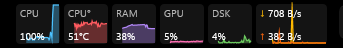

## Highlights

- **Graphs or text**, with one of twenty graph styles, a color and a popup detail chosen per item, in a plain strip, one pill or a chip per item. Readings keep the width of their widest value, so the text beside them never shifts as they change.
- **Hover popups** at three levels of detail, on the same backgrounds as the desktop widget: Solid, Glass, Liquid glass, Acrylic or Clear.
- **A system details window**: processor, memory modules, graphics, drives, network, motherboard and every live sensor.
- **GPU monitoring for any vendor**, read the way Task Manager does, with no drivers or vendor SDKs.
- **CPU temperature and power, if you opt in**, through an optional [sensor service](#sensor-service).
- **A desktop widget** with sparklines, tiles, meters, dials or device cards, nine layouts, solid, glass, liquid glass, acrylic or clear backgrounds, and an option to dock it to a screen edge, where it waits until you push the pointer against it.
- **Themes** you can save and share, or design on [Pulsar Themes](https://oman-rod.github.io/Pulsar/).
- **Frame rates and game sessions**: the frame rate of the app in front, a strip on the game's monitor while you play, and a summary when the game closes.
- **Light**: about 20 MB of memory and well under 1% CPU, and it [pauses while nobody can see it](#staying-out-of-the-way). No admin rights, no drivers and no background services unless you add the sensor service.
- **No telemetry.** See [Privacy](#privacy).

## Install

Pulsar needs Windows 11.

| Method | How |
|---|---|
| **winget** | `winget install oMaN-Rod.Pulsar` |
| **Installer** | Download `pulsar-<version>-setup.exe` from [Releases](https://github.com/oMaN-Rod/Pulsar/releases). It installs for your user only, adds a Start Menu entry, and can start Pulsar when you sign in. |
| **Portable** | Download the zip from [Releases](https://github.com/oMaN-Rod/Pulsar/releases), extract it anywhere and run `pulsar.exe`. |
| **Cargo** | `cargo install --locked pulsar-monitor`, then run `pulsar`. |

Code signing through the SignPath Foundation starts with the next release; see the [code signing policy](#code-signing-policy). Until then, and while a new signed release builds up reputation, SmartScreen may warn that the installer is from an unknown publisher. Choose **More info → Run anyway**.

<details>
<summary><b>More about installing with Cargo</b></summary>

`cargo install` puts `pulsar.exe`, `pulsar-settings.exe`, `pulsar-details.exe` and `pulsar-sensors.exe` in `%USERPROFILE%\.cargo\bin`. Building needs Rust 1.92+, the MSVC build tools and the Windows SDK.

To remove it, turn off *Start with Windows* in Settings, exit Pulsar, then run `cargo uninstall pulsar-monitor`. If you set up the [sensor service](#sensor-service), remove it first.

</details>

## The overlay

Pulsar sits beside the tray or at the left edge of the taskbar, nudged by an offset if you like, or floats anywhere on screen. It survives Explorer restarts, taskbar moves, auto-hide, DPI changes and multiple monitors, and fades out while a fullscreen game or video is in front. On the taskbar its items are attached as a child window, which keeps them visible while Start is open; if that ever causes trouble, turn off *Attach to the taskbar* in Settings.

### Graphs or text

| | |
|---|---|
| **Graphs** |  |
| **Graphs with icons** | 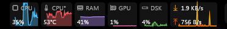 |
| **One-letter labels** | 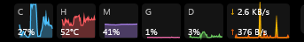 |
| **Single-line graphs**, for short taskbars | 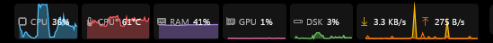 |
| **Vertical labels**, with the value beside them | 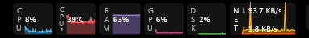 |
| **Text** | 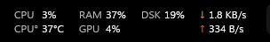 |
| **Text, one-letter labels** | 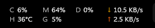 |
| **Text, icons alone** | 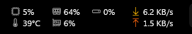 |
| **Text, label above the value**, chosen per item | 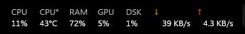 |

### Shapes

The items sit in a plain strip, in one pill around them all, or in a chip each. Set the corner radius, or leave the ends fully round, in *Settings → Layout → Overlay*.

| | |
|---|---|
| **Pill** |  |
| **Chips** | 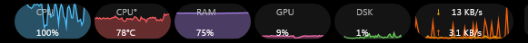 |

### A style and color per item

Each item draws an area graph, a line, bars, a dot matrix, a level meter, a segment meter, a bullet meter with its recent peak and thresholds, a heat strip of its recent samples, a range rail from its recent low to high, a spark underline, a ring, or just its text. Items with a load scale can also tint their tile or show a status bubble beside the text, in the color of their load. Network can mirror download and upload around a center line, ping can show an uptime strip that marks lost packets, and the battery can show a cell that fills with its charge. The CPU and GPU can combine load bars with a temperature dot, the CPU can show meters per core type on hybrid processors, and any item can add a trend arrow. The CPU can also show a bar or a heat cell per core, with peak marks and efficient cores set apart on the bars. It can use its own color, your Windows accent color, or a color that turns green, yellow, orange and red as its load rises, at thresholds you can set.

| | |
|---|---|
| **Area** |  |
| **Line** | 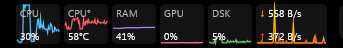 |
| **Bars** | 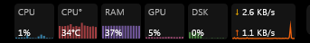 |
| **Level meter** | 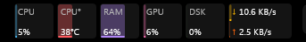 |
| **Segment meter** | 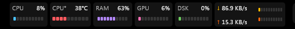 |
| **Spark underline** | 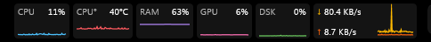 |
| **Ring** | 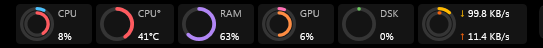 |
| **Dot matrix** | 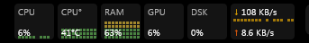 |
| **Heat strip** | 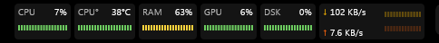 |
| **Bullet meter** | 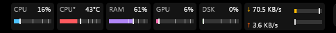 |
| **Range rail** | 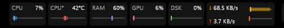 |
| **Status tint** | 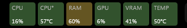 |
| **Status bubble** | 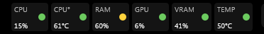 |
| **Load with temperature**: CPU and GPU | 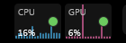 |
| **Core bars**: CPU | 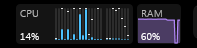 |
| **Heat cells**: CPU | 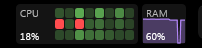 |
| **Core type meters**: CPU | 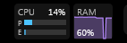 |
| **Mirror bars**: network | 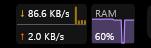 |
| **Uptime strip**: ping | 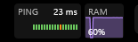 |
| **Battery cell**: battery | fills with its charge, and shows a bolt while charging |
| **Mixed**: area, line, meter, bars and text only | 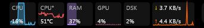 |
| **Trend arrow**, on any style | 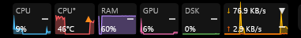 |
| **Color by load** | 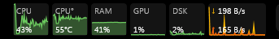 |
| **Color by load, text** | 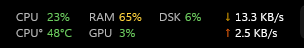 |
| **Color by load, your own colors** | 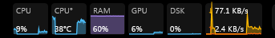 |

> [!TIP]
> Right-click an item on the taskbar to change its style, color and popup detail, swap it with its neighbour, or hide it.

### Every item

CPU, CPU temperature, CPU power, CPU clock, memory, chipset temperature, GPU, GPU temperature, GPU memory, GPU power, disk, drive temperature, network, ping, battery and frame rate. Show any of them, in any order: drag an item along the taskbar to move it, or drag its handle in *Settings → Items*.

GPU power is in watts, for NVIDIA cards, read through the management library their driver installs; no sensor service is needed. With several cards it adds up those that report their power. A laptop GPU that Windows has powered down counts as 0 W and is not woken to ask.

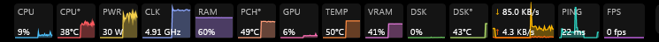

### Floating

Detach Pulsar from the taskbar, drag it anywhere and lock it in place. A floating pill or chips blur what is behind them.

| Panel | Pill |
|:---:|:---:|
| 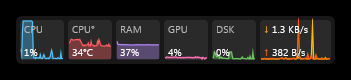 | 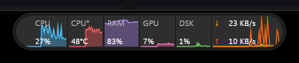 |

### On a full taskbar

Pulsar stays where you put it until it would cover a taskbar button. Then its items get more compact and go one at a time, from the side you choose. With no room for any, it floats above the taskbar, shows a reading in its tray icon, or stays hidden, as you prefer; items return once there is room. Pulsar asks Windows where the buttons are and never touches the taskbar itself, so a custom taskbar that does not report them keeps Pulsar in its usual place, where it can cover them.

### Desktop widget

A panel on the desktop with a section per item, like a popup that stays open. It sits behind your windows and comes forward when you show the desktop, stays on top, or docks to a screen edge. Drag it anywhere, and turn it on or off with the switch at the top of *Settings → Widget* or from the menu.

- **Style:** sparklines, tiles, meters, dials or device cards (the device, a large value beside its graph, then details), for all items or per item, at Simple, Standard or Detailed. The CPU can also show a core wall: a tall bar per logical processor with its peak, with performance and efficient cores apart.
- **Layout:** let Pulsar pick one, or choose Dashboard, Lanes, Tiles, Meters, Dials, Strip, Rings or Focus from the pictures in *Settings → Widget → Look*. The widget either fits its content or takes the size you drag its edges to. Dashboard cards are all the same height, so its rows line up; sized by dragging, they share the height between them.
- **Focus:** one item at a time, with a large value and graph. It can step to the next item on a timer, with a fade or slide, or when you press a shortcut.
- **Material:** Solid; Glass, Liquid glass or Acrylic, which blur what is behind the widget; or Clear, which never blurs, for use over games. Glass is frosted; Liquid glass blurs less and catches the light along its rim. Both can take a tint from the background color. Items can share one panel or each have a card of their own, with an optional border.
- **Network:** download and upload as meter bars, with their rates under the direction names or on one line, and upload in a color of its own.
- **Order:** the widget can show its own items in its own order: drag the handles in *Settings → Widget → Items*, or hold <kbd>Shift</kbd> and drag an item on the widget (no <kbd>Shift</kbd> needed once it is locked).

| Sparklines | Tiles | Meters |
|:---:|:---:|:---:|
| 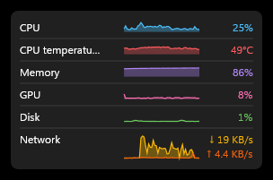 | 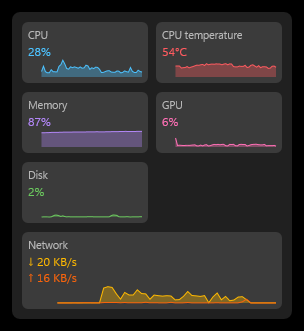 | 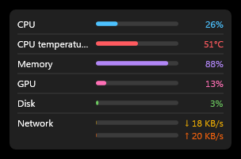 |
| **Dials** | **Device cards** | **Core wall** |
| 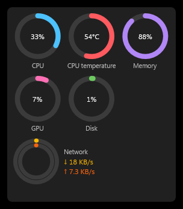 | 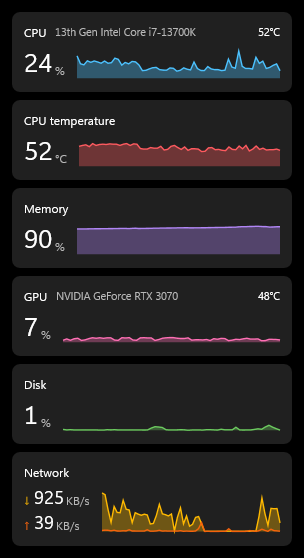 | 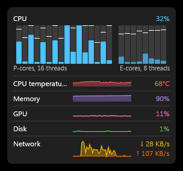 |
| **Glass, separate cards** | **Liquid glass, separate cards** | **Acrylic** |
| 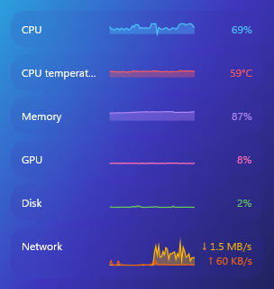 | 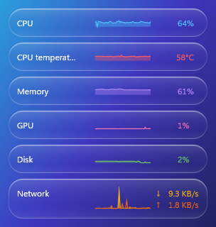 | 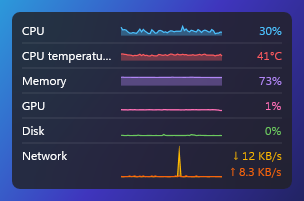 |
| **Detailed** | **Own background color** | |
| 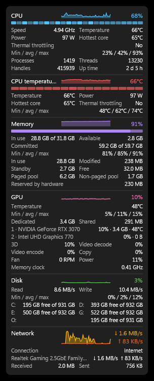 | 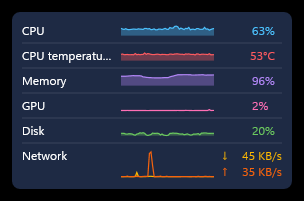 | |

<details>
<summary><b>More layouts</b></summary>

| Focus |
|:---:|
| 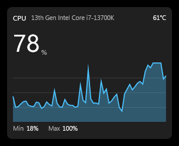 |

**Dashboard**

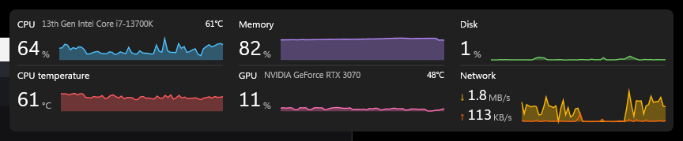

**Strip**

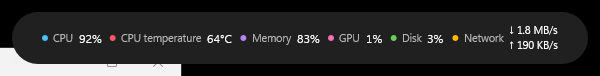

**Rings**


</details>

#### Docked to a screen edge

Choose *Docked to a screen edge* in *Settings → Widget → Placement*, then pick the edge and monitor. The widget stays out of sight until you push the pointer past that edge, and hides again shortly after the pointer leaves, including when you push it open and move away without reaching it, when you click elsewhere, or when you press <kbd>Esc</kbd>. Where the edge meets another monitor the pointer crosses over instead, so resting at the edge for a moment opens it. You can set how hard to push, how long it waits before hiding, a thin line where it waits, and whether it opens over fullscreen apps by shortcut, by shortcut and edge, or not at all. The widget's shortcut also shows it.

### In games

Two options in *Settings → Sensors*, both off until you turn them on:

- **A strip in games:** while a game is in front, its frame rate and your taskbar items appear as one line of text in the top-left corner of its monitor. Clicks pass through it to the game. Windows does not let anything draw over exclusive fullscreen, so this works for borderless and windowed games.

  
- **A summary when a game closes:** a notification with the time played, average frame rate, 1% low and peak CPU and GPU temperatures. Each session is also added to `sessions.csv` in the logs folder.

The frame rate and temperatures need the [sensor service](#sensor-service). A game is any app Windows recognises as one, as Game Bar does. To change that for an app, bring it to the front, right-click Pulsar and choose *Count … as a game*.

### Alerts

Pulsar can warn you with a notification when the CPU or GPU stays above a temperature for half a minute, when the battery runs low while unplugged, or when a drive is nearly full. Each alert is off until you turn it on in *Settings → General*, and fires again only once its reading has recovered. The CPU temperature alert needs the [sensor service](#sensor-service).

### Shortcuts

Set keyboard shortcuts in *Settings → Shortcuts* to show or hide Pulsar, open the system details window, start or stop recording, switch to the next profile, turn the desktop widget on or off, and step to the next or previous item in the widget's Focus layout. They work anywhere in Windows and are not set until you choose them; each has a button to clear it.

<details>
<summary><b>Shortcuts in Settings</b></summary>


</details>

### Recording

Choose *Record to CSV* from the menu to write every sample to a new file in `Documents\Pulsar`, until you choose it again. Each reading Pulsar is sampling gets a column named for it and its unit, such as `cpu_temp_c` or `net_down_bps`; rates are in bytes per second and sizes in bytes.

### Profiles

Save the current setup as a named profile in *Settings → Profiles*, such as one for gaming and one for the desk, and switch between them there or from *Profiles* in the menu. A profile keeps the items, layout, theme, popups, widget, units, drives and network. Language, startup, the update interval, games, alerts and shortcuts are the same in every profile. The menu ticks the profile that matches the current settings. Each profile shows as a card with its theme, item count and whether it has the widget. A keyboard shortcut, set in *Settings → Shortcuts*, switches to the next profile.

| Settings | Menu |
|:---:|:---:|
|  |  |

### Themes

Eight built-in themes set the item, label, value, tile and panel colors, each with a variant for light taskbars. Click one in *Settings → Theme* to apply it, change any color on top, and save the result as your own theme: a small file in `%APPDATA%\Pulsar\themes` you can share.

For more, open [Pulsar Themes](https://oman-rod.github.io/Pulsar/), or *More themes* in *Settings → Theme*. It shows Pulsar's overlay, popups and widget on an emulated Windows 11 desktop, so you can:

- try the built-in and community themes, and change every color and setting live, in night and day
- generate a theme from a color or from your wallpaper
- export the theme, and a profile with your items, styles and layout, ready for Pulsar's themes and profiles folders
- share your theme with the community gallery through a GitHub issue


### Staying out of the way

While the display is off, the PC is locked or the session is disconnected, Pulsar stops sampling and pinging, and resumes within a couple of seconds of your return. It keeps sampling if an alert is on, a recording is running or a game session is open, so those have no gaps. It asks Windows to run it in efficiency mode, and *Update interval on battery* in *Settings → Sensors* can slow its readings while unplugged.

### Make it yours

- label, value and item colors, with separate label and value colors for a light taskbar
- tile and panel backgrounds, which help on Windhawk, TranslucentTB and similar
- any installed font, bold optional
- in text mode, any item's label above its value instead of before it
- temperatures in °C or °F, memory and GPU memory as a percentage or the amount in use, network rates in bytes or bits per second, a minimum speed below which the taskbar and widget show 0, upload shown above download if you prefer, and a separate color for upload
- a dot before the network arrows in the color of the connection: internet, the local network only, or none, as Windows judges it for the tray's network icon
- network as download, upload or both, on one graph tile or a tile for each, with a separate choice for the popup
- each drive as its own item, showing its activity or used space; each GPU with its own load, temperature and memory; and all physical network adapters, one, or several side by side

## Popups

Rest the mouse on an item to see its graph and details. Choose how much each popup shows, for all items or per item:

| Simple | Standard | Detailed |
|:---:|:---:|:---:|
|  |  |  |
| The value and its graph | The main readings and top processes | Everything Pulsar reads, plus the low, average and high of the graph |

Popups take the same materials as the desktop widget, in *Settings → Popups*. Acrylic, the default, blurs what is behind them; Glass and Liquid glass can take a tint:

| Acrylic | Liquid glass | Solid |
|:---:|:---:|:---:|
|  |  |  |

<details>
<summary><b>What each popup shows</b></summary>

| Item | Standard | Detailed adds |
|---|---|---|
| **CPU** | clock speed, per-core load, top processes, and with the sensor service temperature, power, hottest core and thermal throttling | process, thread and handle counts, and up time |
| **CPU temperature** | temperature, power, hottest core, thermal throttling | per-core temperatures |
| **CPU power** | temperature, power, hottest core, thermal throttling | cores, graphics and memory power, TDP, sustained and burst limits, and per-core power |
| **CPU clock** | average and fastest core | per-core clocks |
| **Memory** | in use, available, committed, top processes | in use, modified, standby and free as a bar, and the kernel pools |
| **Chipset temperature** | chipset, CPU, GPU and hottest drive | |
| **GPU** | temperature, dedicated and shared memory, each GPU's load, memory and temperature, top processes | engines, fan, power, memory clock, and hot spot and memory temperature where the card has them |
| **GPU temperature** | fan, power, memory clock, hot spot, memory temperature, each GPU's temperature | |
| **GPU memory** | dedicated memory in use out of the total, shared memory, how full each GPU's memory is | |
| **GPU power** | share of the power limit, load and temperature, while the GPU and GPU temperature items are on | |
| **Disk** | read and write rates, chosen drives, top processes by I/O | free space per drive |
| **Drive temperature** | each drive, by letter and model; hard drives are read at most every 5 minutes and show the reading's age, or that they are asleep | |
| **Network** | whether there is a connection to the internet, traffic per adapter, numbered when each has its own cells | totals since Pulsar started |
| **Ping** | host, min/avg/max, packet loss | jitter |
| **Battery** | state, time remaining | charge rate, energy, capacity when new, health, charge cycles, voltage |
| **Frame rate** | application, frame time, 1% and 0.1% lows, how often its monitor's picture changed | min/avg/max |

Every Detailed popup except Network also shows the low, average and high of its graph.

</details>

<details>
<summary><b>Every popup, Detailed</b></summary>

| | | |
|:---:|:---:|:---:|
|  |  |  |
| CPU | CPU temperature | CPU power |
|  |  |  |
| CPU clock | Memory | Chipset temperature |
|  |  |  |
| GPU | GPU temperature | Disk |
|  |  |  |
| Drive temperature | Network | Ping |
|  |  | |
| Frame rate | GPU memory | |

</details>

## System details window

<kbd>Ctrl</kbd>+click the overlay, or choose *System details…* from its menu, for a CPU-Z-style view of the whole machine. It opens on the clicked item's page, with the hover graphs and their full history.

| Page | What it shows |
|---|---|
| **Overview** | a summary of the machine, live graphs for every item, and temperatures, power and up time |
| **Processor** | per-core load, clock and temperature as a matrix, strips, rings or a graph per thread, with power, voltage, caches and instruction sets |
| **Memory** | usage, commit, timings and each module |
| **Graphics** | utilisation, temperature, engines, graphics memory and every adapter with its PCIe link |
| **Storage** | activity, transfer rate, and each drive's temperature, limits and free space |
| **Network** | traffic and latency history, and every adapter's link speed and addresses |
| **System** | motherboard, chipset, BIOS and Windows |
| **Sensors** | every reading in a collapsible tree, with its current value, low and high |


<details>
<summary><b>More pages</b></summary>

**Processor**


**Memory**


**Graphics**


**Storage**


**Network**


**System**


**Sensors**


</details>

## Using Pulsar

| Where | Action | What happens |
|---|---|---|
| Overlay | Rest the mouse on an item | its popup |
| Overlay | Left-click | opens Task Manager |
| Overlay | <kbd>Ctrl</kbd>+click | opens the system details window on that item's page |
| Overlay | Right-click | the menu, with the clicked item's own options at the top |
| Overlay | Drag an item | moves the item among the others |
| Overlay, floating and unlocked | Drag | moves the overlay; hold <kbd>Shift</kbd> to move an item instead |
| Tray icon | Left-click | opens Settings |
| Tray icon | Right-click | the menu |
| Start menu | Launch Pulsar while it runs | opens Settings |

The tray icon can be turned off in *Settings → General*. It then appears only while a notification is showing, and the overlay's right-click menu still reaches Settings.

### The menu

Switch between graphs and text, show or hide items, and set popup detail, units, the update interval, profiles, labels, icons and floating mode, all without opening Settings.

| The clicked item's options | Popups |
|:---:|:---:|
|  |  |

### Settings

Every option, applied as you change it. Each page has a color of its own, the longer pages are split into tabs, and the ⓘ beside a setting explains it. Search finds any setting and opens its page and tab.

<details>
<summary><b>Settings pages</b></summary>

**Items:** the items in order on the left, with a switch for each; the chosen item's color, labels, graph style, trend arrow, tile size and popup on the right. Drag a handle, or press <kbd>Alt</kbd>+<kbd>↑</kbd>/<kbd>↓</kbd>, to reorder. The *Load colors* tab sets the colors for color by load.


**Layout:** graphs or text, the shape, labels and icons on *Overlay*; the font and spacing on *Text*; where the overlay sits, and what happens when the taskbar is full, on *Position*


**Theme:** themes, label and value colors paired for dark and light taskbars, and tile and panel colors with their opacity


**Popups:** details on hover, detail, material and glass tint, graph, top processes and size


**Widget:** where it sits, on *Placement*; its size, layout, style, material and detail, on *Look*; which items it shows, in what order, on *Items*


**Sensors:** whether the sensor service and PawnIO are working, frame rate, games, units, and how often Pulsar samples, on mains and on battery


**Devices:** drives, GPUs, network adapters with their rates and minimum speeds, and the ping host, a tab each


**Profiles:** save, apply, update and delete profiles


**Shortcuts:** keyboard shortcuts for Pulsar and the widget

**General:** language, start with Windows, update checks, the tray icon, alerts, and resetting everything


**About:** the version and whether an update is out, links, the settings and logs folders, and diagnostics

</details>

## Sensor service

Everything Pulsar shows by default is read without administrator rights. A few readings need kernel access, which Pulsar does not have and does not ask for by default. Two optional pieces provide them, and both need administrator rights:

- **[PawnIO](https://pawnio.eu)** ([source](https://github.com/namazso/PawnIO)), an open-source signed driver by namazso. It only runs modules signed by its author, and the ones Pulsar uses can read a fixed list of registers.
- **The Pulsar sensor service** (`pulsar-sensors.exe`), which reads temperatures and power draw through PawnIO once a second and publishes those numbers. It runs as a Windows service from `%ProgramFiles%\Pulsar`. Pulsar itself stays unelevated. The only input the service takes is a yes-or-no request for frame rates.

### Without the service

Pulsar falls back to what Windows itself publishes:

- **CPU power** comes from the Energy Meter Interface, on many recent Intel and AMD systems. It reads the same counters as the service, including the cores, graphics and memory parts.
- **CPU temperature** comes from the ACPI thermal zones. Many desktops only publish placeholders there, so Pulsar ignores readings that can't be a running CPU and shows a dash instead.

### Frame rate

The *Frame rate* item needs the service, but not PawnIO.

- **How it's measured:** the service listens to the present events that DXGI, Direct3D 9 and the graphics kernel already log through Event Tracing for Windows, which only an administrator can do. The trace stops a few seconds after the item is turned off.
- **Nothing touches the game:** nothing is loaded into it or read from its memory, which is what anti-cheat software looks for.
- **What it shows:** how often the app in front hands a frame to Windows, counting the GPU process that browsers draw from. An app that isn't drawing shows 0 fps.
- **Monitor rate:** the popup also shows how often the picture changed on that app's monitor. Windows combines every app into one picture per refresh, so this never exceeds the refresh rate, except for a fullscreen game with V-Sync off.
- **A game on another monitor:** to watch it while you work elsewhere, choose its monitor under *Settings → Sensors → Frame rate*.

### Setting it up

1. Install the pieces:
   - **Installer:** tick the boxes on its *CPU temperature* page. Run the installer again to add or remove them later.
   - **winget:** `winget install` runs the installer silently, which never asks for administrator rights and so skips that page. Run `winget install -i oMaN-Rod.Pulsar` to see it, or follow the next step using `%LOCALAPPDATA%\Programs\Pulsar\pulsar-sensors.exe`.
   - **Portable zip or Cargo:** install PawnIO (`winget install namazso.PawnIO`), then run `pulsar-sensors.exe --install` from an administrator terminal.
2. Turn on *CPU temperature*, *CPU power*, *Chipset temperature* or *Frame rate* in *Settings → Items*. *Settings → Sensors* shows whether the service and PawnIO are working.

> [!NOTE]
> The service runs from its own copy of `pulsar-sensors.exe`. The installer's wizard refreshes that copy, but a silent upgrade (`winget upgrade`) and `cargo install` do not, so run `pulsar-sensors.exe --install` again after those if Pulsar says the service needs updating.

To remove the service, run `pulsar-sensors.exe --uninstall` from an administrator terminal. Uninstalling Pulsar from Windows Settings or winget does this for you; `cargo uninstall` and deleting the portable folder do not.

Without the service, the *CPU temperature*, *CPU power*, *Chipset temperature* and *Frame rate* items show "—" and their popup says what is missing; the other readings are simply left out.

<details>
<summary><b>What needs the sensor service</b></summary>

| Reading | Built in | With the sensor service |
|---|:---:|---|
| CPU usage, clock speed, per-core load, top processes | ✓ | |
| Memory, disk, network and ping | ✓ | |
| Drive temperature, for drives that report one | ✓ | |
| GPU board maker and PCIe link, chipset model (details window) | ✓ | |
| GPU usage, VRAM, temperature, fan and power | ✓ | |
| CPU temperature | | Intel, and AMD Ryzen (Zen and later) |
| CPU power | | Intel, and AMD Ryzen (Zen and later) |
| Chipset temperature | | Intel, chipsets from the 8 series on |
| TDP and power limits (details window, CPU power popup) | | Intel |
| Multiplier range and ring clock (details window) | | Intel |
| Memory timings and clocks (details window) | | Intel 12th–14th gen; AMD Ryzen without the controller clock |
| Hottest core (popups) | | Intel |
| Per-core temperature (details window, CPU temperature popup) | | Intel |
| Per-core clock (details window, CPU clock popup) | | Intel, and AMD Ryzen |
| Per-core voltage (details window) | | Intel |
| Per-core power (details window, CPU power popup) | | AMD Ryzen |
| Cores, integrated graphics and memory power (details window, CPU power popup) | | Intel; cores only on AMD Ryzen |
| Thermal throttling (popups) | | Intel |
| GPU hot spot (popups) | | NVIDIA RTX 50 series |
| GPU memory temperature (popups) | | NVIDIA RTX 30 series and later |
| Frame rate | | Any CPU, without PawnIO |

The GPU rows appear only where the card has those sensors, and they need one of the supported CPUs.

</details>

## Languages

Pulsar is available in English, Spanish (Español), Simplified Chinese (简体中文), Korean (한국어) and Japanese (日本語). It follows the Windows display language; pick another under *Settings → General → Language*. To add or improve a translation, see [docs/translating.md](https://github.com/oMaN-Rod/Pulsar/blob/main/docs/translating.md).

## Settings and files

| What | Where |
|---|---|
| Settings, applied live | `%APPDATA%\Pulsar\config.toml` |
| Logs, crash reports and diagnostics | `%LOCALAPPDATA%\Pulsar\logs` |
| Game sessions | `sessions.csv` in the logs folder |
| Recordings | `Documents\Pulsar\readings-*.csv` |
| Profiles | `%APPDATA%\Pulsar\profiles` |
| A settings file that could not be read | backed up as `config.toml.bak`, and defaults are used |

## Privacy

Pulsar makes only two kinds of network request:

- **Ping:** pings the host you choose, `1.1.1.1` unless you change it. Ping is off until you enable the Ping item.
- **Update check:** asks GitHub's releases API about new versions once a day. Turn it off in *Settings → General*. Nothing is ever downloaded or installed automatically.

The installer goes online only if you tick PawnIO on its *CPU temperature* page, when it runs `winget install namazso.PawnIO`.

There is no telemetry.

## Code signing policy

Free code signing provided by [SignPath.io](https://about.signpath.io), certificate by [SignPath Foundation](https://signpath.org).

Only the installer and the programs built from this repository are signed: `pulsar.exe`, `pulsar-settings.exe`, `pulsar-details.exe` and `pulsar-sensors.exe`. They are built and submitted for signing by the [Release workflow](https://github.com/oMaN-Rod/Pulsar/blob/main/.github/workflows/release.yml) on GitHub-hosted runners, from a release tag, and each release is approved by hand before it is signed. The PawnIO driver that the optional sensor service uses is not built here and is not signed by this project.

| Role | Members |
|---|---|
| Committers and reviewers | [oMaN-Rod](https://github.com/oMaN-Rod) |
| Approvers | [oMaN-Rod](https://github.com/oMaN-Rod) |

Changes from anyone else arrive as pull requests and are reviewed before they are merged.

Privacy policy: see [Privacy](#privacy), which lists every network request Pulsar and its installer can make, and how to turn each off.

## Troubleshooting

- **Something looks wrong:** open *Settings → About → Logs* and look at `pulsar.log`.
- **Pulsar crashed:** it writes a `crash-*.txt` report to the logs folder and offers to open it the next time it starts.
- **A reading is missing or wrong:** *Settings → About → Diagnostics → Save report*, or `pulsar --diag [file]`, writes every reading Pulsar can take, and how long each kind takes to read, to `diagnostics.txt` in the logs folder.

Then [open an issue](https://github.com/oMaN-Rod/Pulsar/issues/new/choose) with the log and any crash or diagnostics report attached.

> [!IMPORTANT]
> The diagnostics report lists process and network adapter names. Read it before sharing.

## Build from source

```
cargo build --release
cargo test --workspace
```

| Script | What it does |
|---|---|
| `scripts\package.ps1` | builds the installer, the portable zip and the winget manifests into `dist\`; needs [Inno Setup](https://jrsoftware.org/isinfo.php) 7, which ships the Simplified Chinese messages |
| `scripts\screenshots.ps1` | captures the overlay in every layout, shape and style, popups, menus, the widget in its styles, materials and layouts, the game strip, every Settings page and tab, and the details window to `target\screenshots\`; `-Publish` adds the images `docs\images` lacks, and `-Replace` names those to overwrite |

The theme site lives in `site/`; see [site/README.md](site/README.md) to run it locally.

Also see the [manual testing checklist](https://github.com/oMaN-Rod/Pulsar/blob/main/docs/testing.md) and the [release guide](https://github.com/oMaN-Rod/Pulsar/blob/main/docs/releasing.md).

## Support

Pulsar is free. If it helps you, you can buy me a coffee.

<a href="https://buymeacoffee.com/i_am_o"></a>
<a href="https://ko-fi.com/i_am_o"></a>

## License

[GPL-3.0-or-later](https://github.com/oMaN-Rod/Pulsar/blob/main/LICENSE). The settings window is built with [Slint](https://slint.dev), used under its GPLv3 option.
